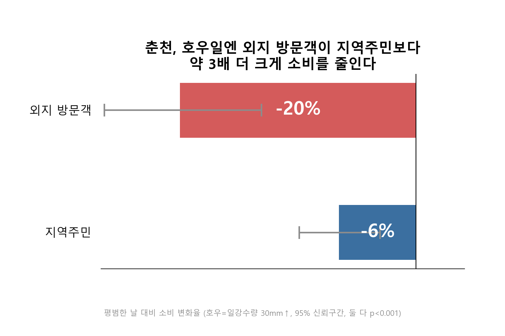
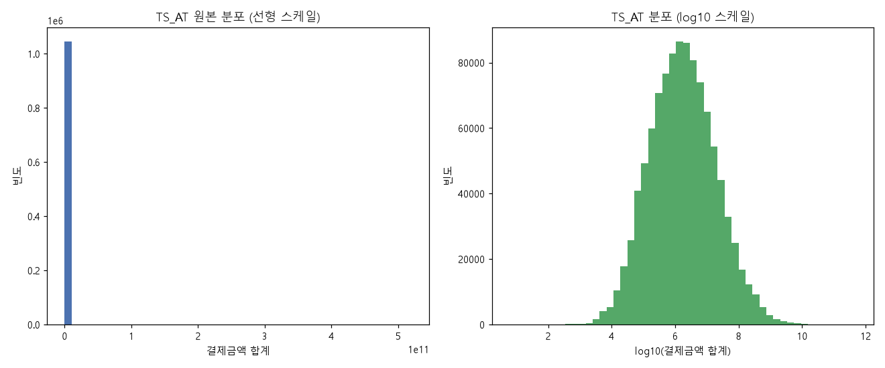
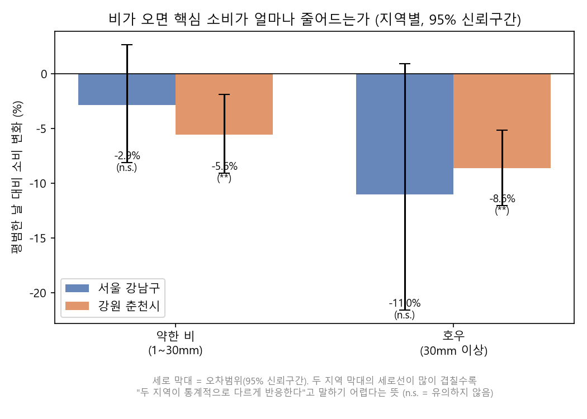
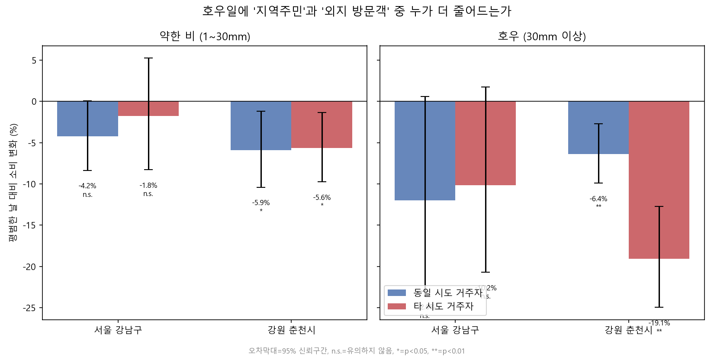
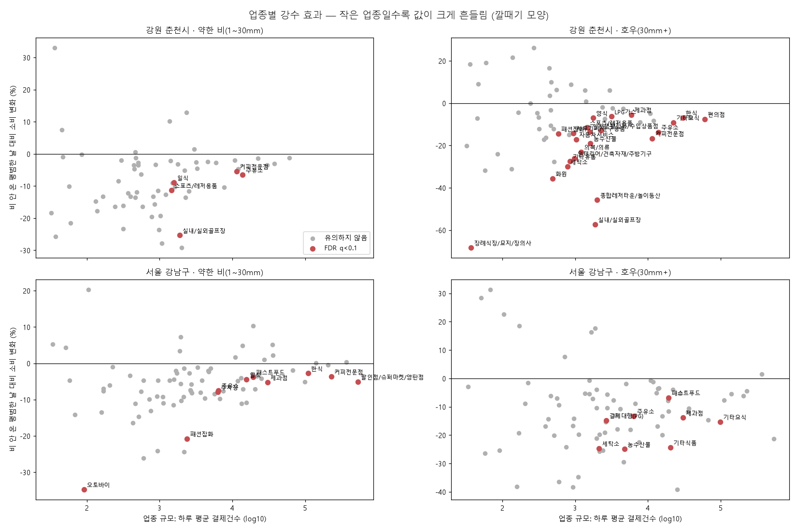
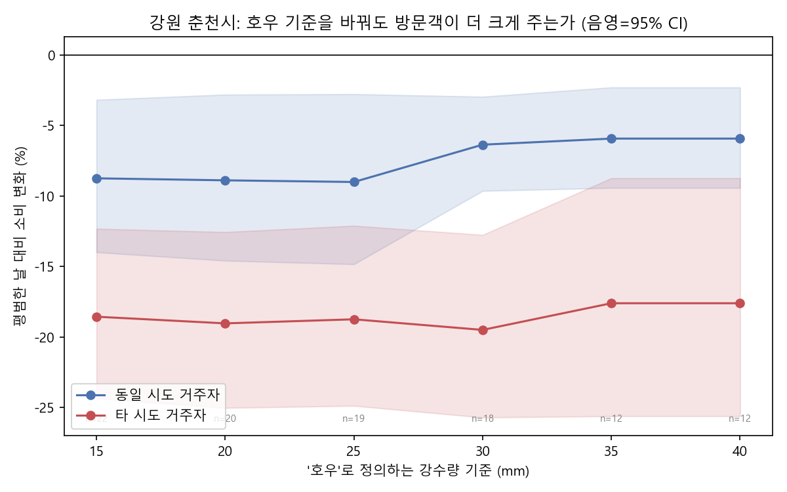

## 2026 빅콘테스트 AI데이터분석 분야 — 개인 프로젝트

#### 기후위기 취약상권 영향 분석: 비가 오면, 어떤 상권이 더 크게 흔들리는가

카드소비 · 유동인구 · 기상 데이터를 결합해, 호우·폭염이 상권 소비에 미치는 영향을 지역 · 고객 유형 · 시간대 · 업종별로 검증했다.

- 분석 지역: 서울 강남구 vs 강원 춘천시 · 기간: 2025-07-01 ~ 12-31 (184일)
- 방법: 로그선형 회귀(OLS) + HAC 표준오차, FDR 다중검정 보정, 상호작용항, 강건성 점검
- 📄 **전체 분석 결과 웹 페이지**: https://hyeonn31.github.io/bigcontest-2026/ · 📊 [포트폴리오 슬라이드](Portfolio_slides.pptx) · 📝 [상세 보고서](REPORT.md)

</br>

> **핵심 결론** — 기후위기는 상권을 균일하게 위협하지 않는다. 춘천 호우일에 **타 시도 방문객 소비는 −19.1%**, **동일 시도 거주자는 −6.4%** 로 방문객이 약 3배 더 크게 줄었다 (두 값 모두 p<0.001, 95% 신뢰구간 겹치지 않음). 외지 방문객 매출 비중이 높은 관광의존형 상권이 구조적으로 취약하다.



</br>

### 데이터셋

| 데이터 | 규모 | 원래 단위 | 주요 컬럼 |
| --- | --- | --- | --- |
| 신한카드 소비 ① | 1,044,710행 | 일 × 지역 × 업종 × 시간대 × 성별·연령 | 결제금액·건수 (법인 포함) |
| 신한카드 소비 ② | 1,806,800행 | 일 × 지역 × 업종 × 고객 거주지(시도) × 성별·연령 | 결제금액·건수 (법인 제외) |
| SK텔레콤 유동인구 | 월별 3종 × 6개월 | 월 × 50m 격자 | 연령별 · 시간대별 · 요일별 인구 |
| 기상청 ASOS | 2지점 × 4,392시간 | 시간 × 관측소 | 기온, 강수량, 풍속, 습도 |

대회 제공 원본은 재배포 제한으로 저장소에 포함하지 않음 (`.gitignore`). 가공 데이터는 `data/processed/`에 있음.

### 데이터 전처리

단위가 다른 세 데이터를 **"하루 × 지역"** 으로 맞춰 `merged_daily.csv` (368행 = 184일 × 2지역)를 만들었다.

- **SK 격자 → 지역**: 지역명 없이 좌표만 있음 → 좌표를 정렬해 값이 크게 점프하는 지점(`X_COORD = 983,000`)으로 강남/춘천을 겹침 없이 분리. 강남 격자 15,261개 × 0.0025km² ≈ 38km²로 실제 면적(39.5km²)과 일치해 검증
- **기상 시간 → 일**: 기상청 관례(01~24시)대로 1시간을 빼 날짜를 정하고 일 단위 집계, 기후 이벤트 플래그 생성
- **방문객 구분**: 가맹점 시도와 고객 거주 시도가 다르면 타 시도 방문객

```python
w["date"] = (w["dt"] - pd.Timedelta(hours=1)).dt.normalize()   # 00:00 관측치는 전날에 속함
weather["heavy_rain_day"] = weather["precip_sum"] >= 30          # 호우: 일 강수량 30mm 이상

core["visitor"] = core["MCT_SGG_CD"].str.split(" ").str[0] != core["CLN_SGG_CD"]
# '서울 강남구'의 '서울'과 고객 거주 시도가 다르면 타 시도 방문객
```

| 기후 이벤트 | 기준 | 강남 일수 | 춘천 일수 |
| --- | --- | --- | --- |
| 폭염 | 일 최고기온 ≥ 33℃ | 24 | 24 |
| 강수일 | 일 강수량 ≥ 1mm | 49 | 48 |
| **호우** | 일 강수량 ≥ 30mm | **15** | **18** |

#### 이슈사항 — 데이터 품질 점검

- **SK 12월 파일 중복**: 시간대·요일 파일의 모든 행이 값까지 똑같이 두 번 들어 있음(92,545 / 121,267행) → 12월 유동인구가 2배로 부풀어 있던 것을 중복 제거 후 재집계
- **강수량 빈칸(결측 표기 QC 9, 1,496건)**: '비 오는 조건'(습도 ≥93% & 기온−이슬점 <1.5℃) 비율이 7.8%로, 실제 비 온 시각(61.2%)이 아니라 일반 빈칸(7.1%)과 비슷 → '강수 없음'으로 처리
- **12/31 기상 누락**: 날짜 기준 차이로 빠진 마지막 날을 추가 수집해 보완
- **세금·미분류 결제가 금액의 49.6%** (세금공과금 28.1%, ZZ_나머지 21.5%): 소수 거액 결제가 하루 합계를 좌우 → 상권 소비가 아닌 두 항목을 뺀 **'핵심 소비'** 를 새로 정의. 이걸 빼기 전 첫 검정은 "기후 효과 없음(p>0.2)"이었음 — **결론을 바꾼 발견**

</br>

### 분석

#### Part1. EDA — 결제금액은 극단적으로 치우쳐 있다



소수 거액 결제 때문에 원본 스케일에서는 대부분이 0 근처에 붙어 있고, log10 스케일에서 종 모양에 가깝다 → 이상치를 잘라내지 않고 **로그 변환**. 종속변수를 log(금액)으로 두면 계수가 곧 "몇 % 변화"로 해석된다.

#### Part2. 모형 — 로그선형 회귀 + 보정 3종

```
log(핵심 소비) = α + Σ 월 더미 + Σ 요일 더미 + β₁·공휴일
                 + β₂·약한비(1~30mm) + β₃·호우(30mm↑) + β₄·폭염(33℃↑) + ε
효과(%) = (exp(β) − 1) × 100     ← '비 안 온 평범한 날' 대비 소비 변화율
```

- **HAC 표준오차**: 비가 며칠씩 이어지는 자기상관 보정 (Newey-West, 최대 3일)
- **FDR 보정**: 업종 145개를 동시 검정할 때 우연한 유의성 제거 (Benjamini–Hochberg, q<0.1)
- **상호작용항**: 두 그룹의 반응 차이 자체를 직접 검정

```python
# scripts/common.py — 모든 검정이 공유하는 함수. 스크립트마다 넣는 변수(terms)만 다르다
def fit_hac(g, y, terms):
    X = pd.get_dummies(g[["month", "weekday"]].astype(str), drop_first=True, dtype=float)
    for c in terms:
        X[c] = g[c].astype(float)
    X = sm.add_constant(X).loc[y.index]
    return sm.OLS(y, X).fit(cov_type="HAC", cov_kwds={"maxlags": 3})
```

#### Part3. 결과 ① 지역 전체로는 애매하지만, 고객을 나누면 뚜렷하다

| 지역 | 대상 | 약한 비 | 호우 |
| --- | --- | --- | --- |
| 춘천 | 전체 | −5.6% (p=0.003) | −8.6% (p<0.001) |
| 춘천 | 동일 시도 거주자 | −5.9% (p=0.015) | **−6.4%** (p<0.001) |
| 춘천 | 타 시도 방문객 | −5.6% (p=0.011) | **−19.1%** (p<0.001) |
| 강남 | 전체 | −2.9% (n.s.) | −11.0% (p=0.069) |
| 강남 | 동일 시도 거주자 | −4.2% (n.s.) | −12.0% (n.s.) |
| 강남 | 타 시도 방문객 | −1.8% (n.s.) | −10.2% (n.s.) |

폭염(33℃↑)은 두 지역 모두 유의한 영향 없음.



강남 호우 −11.0%는 95% 신뢰구간(−21.6 ~ +0.9%)이 0을 포함해 불확실, 춘천 −8.6%는 유의.



춘천 호우일: 타 시도 −19.1% (CI −25.0 ~ −12.7%) vs 동일 시도 −6.4% (CI −9.9 ~ −2.7%) → 신뢰구간이 겹치지 않는다.

#### Part4. 결과 ② 시간대 · 업종

**시간대**: 춘천은 호우일에 모든 시간대가 감소(00~05시 −8.1%, 06~11시 −12.4%, 12~17시 −6.5%, 18~23시 −10.3%). 하루 중 시간대 **비중**의 변화는 최대 ±4%로 작아, 특정 시간대 쏠림은 핵심 축이 아님.

**업종**: 춘천 64개 · 강남 81개 업종 검정, FDR 통과 업종 — 호우 기준 춘천 23개, 강남 8개.



| 춘천 · 호우 (상위) | 효과 | 방문객 비중 | q |
| --- | --- | --- | --- |
| 실내/실외골프장 | −57.3% | 78% | <0.001 |
| 종합레저타운/놀이동산 | −45.8% | 80% | 0.005 |
| 화원 | −35.6% | 34% | <0.001 |
| 세탁소 | −30.0% | 9% | <0.001 |
| 의복/의류 | −23.0% | 10% | <0.001 |
| 커피전문점 | −16.6% | 20% | <0.001 |
| 주유소 | −13.6% | 15% | <0.001 |
| 편의점 | −7.6% | 18% | <0.001 |

작은 업종일수록 값이 크게 흔들리는 깔때기 모양이지만, 하루 1만 건 이상의 큰 생활 업종(편의점·주유소·커피전문점)도 일관되게 감소한다. 전체 목록은 [웹 페이지](https://hyeonn31.github.io/bigcontest-2026/#r-industry) 참고.

#### Part5. 가설 검정 — 틀리면 주장을 좁혔다

| 가설 | 검정 | 결과 |
| --- | --- | --- |
| A. 방문객 비중이 높은 **업종**일수록 비에 약하다 | 업종별 방문객 비중 vs 비 효과 스피어만 상관 | 춘천 ρ=−0.04 (p=0.74), 강남 ρ=0.16 (p=0.16) → **기각** |
| (a) 레저·야외 업종이 생활 업종보다 더 준다 | 그룹 평균 차이 순열검정 | 춘천은 맞지만(p=0.030) 강남은 반대 방향 → **기각** |
| (c) 호우일 특정 시간대에 소비가 쏠린다 | 시간대 비중 회귀 | 변화 최대 ±4% → **기각** |
| (b) 타 시도 방문객이 동일 시도 거주자보다 더 준다 | log(타 시도/동일 시도) 회귀 | 춘천 −13.6% (p<0.001) → **채택** |
| B. 강남은 지하철·지하상가가 충격을 흡수한다 | 지역 × 호우 **상호작용항** | +5.7%, **p=0.399** → **기각**, 지역 간 비교 주장은 하지 않음 |

지역별 결과를 따로 보면 "강남은 유의하지 않고 춘천은 유의"라 강남이 안전해 보이지만, 차이 자체를 검정하니 근거가 없었다. 그래서 최종 주장을 **"춘천 안에서, 방문객이 지역주민보다 더 크게 준다"** 로 좁히고, 이를 일반화해 **"외지 방문객 매출 비중이 높은 상권 = 기후 취약 상권"** 이라는 조작적 정의를 제안했다.

#### Part6. 강건성 검증



| 점검 | 결과 |
| --- | --- |
| 호우 기준 15 / 20 / 25 / 30 / 35 / 40mm | 전 구간에서 타 시도(−17.6 ~ −19.5%)가 동일 시도(−5.9 ~ −9.0%)보다 크게 감소, 모두 p<0.01 |
| 전일 강수 지연효과 | 전일 호우 효과 없음 (p=0.46 ~ 0.73), 당일 효과 유지 |
| 폭염 기준 30 ~ 35℃ | 전 구간 유의하지 않음 → "폭염 영향 없음" 결론도 강건 |

</br>

### 결론

- **시사점**: 카드 결제 데이터의 고객 거주지 비중만으로 별도 설문 없이 "상권 기후 취약도"를 저비용으로 지표화할 수 있다. 카드사는 업종·지역별 비 민감도를 날씨 연동 소상공인 상품의 리스크 근거로 활용할 수 있다.
- **한계**: 기상 관측소 도시당 1곳(강남구는 종로구 관측소 대리값), SK 유동인구는 월×요일 평균 패턴이라 배경 지표로만 사용, 비교 지역 2곳, 연관성 분석이며 인과 확정은 아님.

</br>

### 저장소 구성 · 재현

| 폴더 | 내용 |
| --- | --- |
| `scripts/` | 전처리·분석·시각화 스크립트 (각 파일 상단에 `[N단계]` 위치와 입력·출력 설명) |
| `data/processed/` | 날짜×지역 집계 데이터, 업종별 결과표 |
| `eda_output/` | 모든 검정 결과 원본 로그 |
| `figures/` | 그래프 |
| `docs/` | 포트폴리오 웹 페이지 (GitHub Pages) |
| `REPORT.md` · `notes.md` | 상세 보고서 · 작업 일지(시행착오 포함) |

```bash
# data/processed/merged_daily.csv 가 있는 상태에서
python scripts/industry_analysis.py        # 지역·시간대·업종별 회귀 (FDR)
python scripts/compare_candidates.py       # 가설 후보 (a)(b)(c) 비교
python scripts/region_interaction_test.py  # 지역 간 차이 상호작용 검정
python scripts/robustness_rain_threshold.py && python scripts/robustness_lag_effect.py && python scripts/robustness_heat_threshold.py
python scripts/pt_figures.py               # 발표용 그래프
python scripts/build_portfolio_pptx.py     # 포트폴리오 슬라이드
```

**기술 스택**: Python, pandas, numpy, scipy, statsmodels, matplotlib, python-pptx, Git
